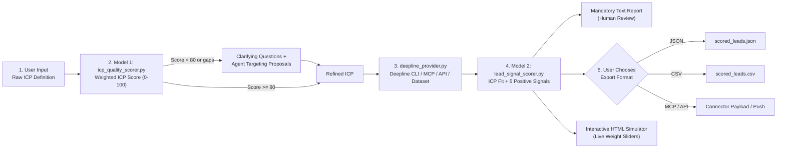
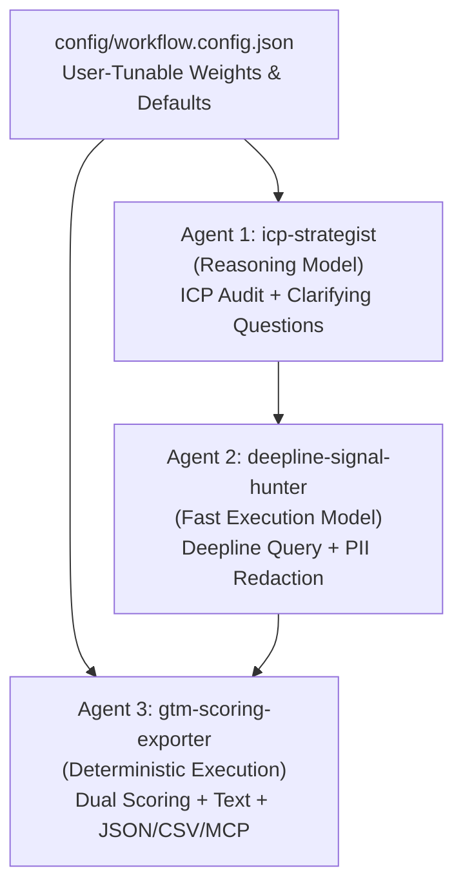
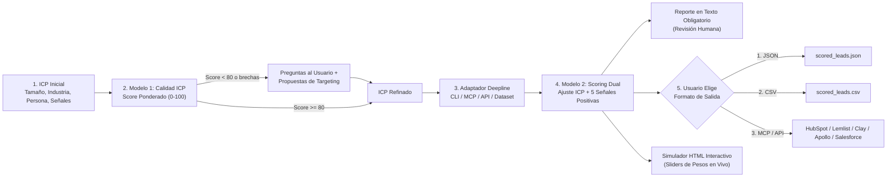

# Deepline ICP & Signals Workflow — Multi-Agent B2B Signal Automation Plugin

[English](#english) · [Español](#español) · **Author:** Santiago Velasquez (GTM Engineer) · **License:** MIT · **Runtime:** Python 3.9+ stdlib · **Zero Background MCPs**

---

<a id="english"></a>
## English

> **TL;DR:** **Deepline ICP & Signals Workflow** is an open-source, **multi-agent GTM plugin and Python pipeline** (zero external dependencies, zero background MCP processes) that turns a raw Ideal Customer Profile (ICP) into signal-prioritized B2B accounts and leads via **Deepline**. It scores ICP readiness (`0–100`), asks clarifying questions before spending enrichment credits, fetches companies and contacts through Deepline (CLI, MCP, REST API, or offline dataset), ranks every lead with a customizable **ICP Fit + 5 Positive Buying Signals** model, and outputs a **mandatory text review** plus user-selectable delivery in **JSON**, **CSV**, or **MCP/API Connector** (`hubspot-mcp`, `lemlist-api`, `clay-webhook`, `apollo-api`, `salesforce-mcp`, `deepline-mcp`, `custom-api`).

### End-to-End Signal Workflow



### Multi-Agent Plugin Architecture (Model-Agnostic)

Packaged as an installable plugin (`plugin.json` + `skills/` + `agents/` + `rules/` + `config/`) with **on-demand execution** so any orchestrator can route each stage to the optimal LLM tier:



### Dual Scoring Models at a Glance

| Model | Purpose | Dimensions / Default Positive Signals & Weights |
|---|---|---|
| **Model 1 — ICP Quality** (`icp_quality_scorer.py`) | Prevents wasted enrichment credits by auditing ICP precision (`0–100`) | `company_size` (`20%`) · `industry_segment` (`25%`) · `buyer_persona` (`25%`) · `suggested_signals` (`20%`) · `geography_and_market` (`10%`) |
| **Model 2 — Lead & Signal Fit** (`lead_signal_scorer.py`) | Combines `icp_fit_score` (`55%`) + `signal_score` (`45%`) into `composite_score` | `company_expansion` (`25%`) · `recent_investment` (`20%`) · `active_hiring` (`20%`) · `new_facility_or_office` (`20%`) · `new_market_entry` (`15%`) + custom signals |

### Quickstart & Plugin Install

```powershell
# Install locally as an Antigravity multi-agent plugin
Copy-Item -Recurse "Demos Workflows/deepline-icp-signals-workflow" "$HOME\.gemini\config\plugins\deepline-icp-signals"
```

```bash
# Run end-to-end offline demo (Model 1 -> Deepline -> Model 2 -> Text + JSON/CSV/MCP + HTML)
python scripts/run_workflow.py \
  --icp examples/icp_industrial_latam.json \
  --config config/workflow.config.json \
  --deepline-input examples/sample_deepline_payload.json \
  --export-format all \
  --connector-target hubspot-mcp \
  --out-dir out \
  --html-out out/signals_dashboard.html
```

### FAQ (English)

- **Why a Plugin instead of a custom MCP server?** Custom MCP servers consume background RAM/processes. This plugin executes zero-dependency Python scripts on demand and plugs into whatever **Deepline** or CRM MCPs the user already runs.
- **Can users customize signal weights and add new buying triggers?** Yes. Edit `config/workflow.config.json` (or pass `--signal-weights`) to adjust `icp_weight`, `signal_weight`, the 5 positive signal weights, or add `custom_positive_signals` without modifying Python code.
- **How are confidential emails and credentials handled?** `deepline_provider.py` redacts literal emails (`email_status` is preserved) and credentials, and connectors default to safe `dry_run_ready` mode unless `--live-push` is explicitly enabled via environment variables.

---

<a id="español"></a>
## Español

> **TL;DR (Resumen ejecutivo):** **Deepline ICP & Signals Workflow** es un **Plugin multiagéntico y pipeline Python open-source** (0 dependencias externas, 0 procesos MCP propios en background) para automatizar prospección B2B basada en señales con **Deepline**. Evalúa la calidad del ICP inicial (`0–100`), genera preguntas y propuestas de targeting antes de gastar créditos, extrae cuentas y contactos con Deepline (CLI, MCP, REST API o dataset local), prioriza cada lead con un modelo dual configurable (**Ajuste ICP + 5 señales positivas**) y entrega **siempre una revisión en texto** más exportación a elección del usuario en **JSON**, **CSV** o **Conector MCP/API**.

### Flujo del Blueprint en 5 Etapas



### Cómo Moldear el Plugin y Sus 3 Subagentes

Cualquier usuario puede adaptar umbrales, pesos y destinos en [`config/workflow.config.json`](./config/workflow.config.json) sin tocar código:

1. **Subagente `icp-strategist`** ([`agents/icp-strategist.md`](./agents/icp-strategist.md)): Audita tamaño de empresa, segmento, buyer persona y señales sugeridas (`icp_quality_scorer.py`), detecta brechas y propone mejoras.
2. **Subagente `deepline-signal-hunter`** ([`agents/deepline-signal-hunter.md`](./agents/deepline-signal-hunter.md)): Traduce el ICP a filtros Deepline (`deepline_provider.py`), etiqueta señales `verified` vs `hypothesis` y redacta PII.
3. **Subagente `gtm-scoring-exporter`** ([`agents/gtm-scoring-exporter.md`](./agents/gtm-scoring-exporter.md)): Califica ajuste ICP + **expansiones de empresa, inversiones recientes, búsqueda activa de personal, apertura de nuevas fábricas/plantas/oficinas y entrada a nuevos mercados** (`lead_signal_scorer.py`), imprime el resumen en texto y despacha al formato elegido (`export_dispatcher.py`).

### Conectores MCP / API Soportados y Opciones de Entrega

| Formato (`--export-format`) | Entregable | Plataformas / Detalles |
|---|---|---|
| `json` | `scored_leads.json` | Auditoría ICP, query Deepline, pesos activos y ranking completo |
| `csv` | `scored_leads.csv` | Tabla UTF-8 BOM lista para Excel, Sheets o carga CRM |
| `connector` | `connector_payload_<target>.json` | `hubspot-mcp`, `lemlist-api`, `clay-webhook`, `apollo-api`, `salesforce-mcp`, `deepline-mcp`, `custom-api` (`dry_run_ready` por defecto) |
| **Siempre incluido** | `review_report.txt` + `demo/index.html` | Revisión completa en texto + simulador web interactivo en vivo |

```bash
# Modo interactivo: el usuario elige en terminal entre JSON, CSV o Conector MCP/API
python scripts/run_workflow.py \
  --icp examples/icp_incomplete_draft.json \
  --config config/workflow.config.json \
  --deepline-input examples/sample_deepline_payload.json \
  --interactive \
  --out-dir out
```

### Preguntas Frecuentes (FAQ)

- **¿Necesito instalar librerías externas o pagar conectores para probarlo?** No. Funciona con Python 3.9+ stdlib y un dataset offline en [`examples/sample_deepline_payload.json`](./examples/sample_deepline_payload.json); cuando actives Deepline CLI, API (`DEEPLINE_API_KEY`) o MCP, cambia de fuente sin reescribir reglas.
- **¿Cómo ajusto el peso de cada señal positiva?** Edita `signal_weights` o añade entradas en `custom_positive_signals` dentro de [`config/workflow.config.json`](./config/workflow.config.json), pásalo con `--signal-weights`, o mueve los sliders en vivo en [`demo/index.html`](./demo/index.html).

---

### Estructura del Repositorio

```text
deepline-icp-signals-workflow/
├── plugin.json                             # Manifiesto oficial del Plugin (0 MCPs en background)
├── config/workflow.config.json             # Pesos, umbrales y conector por defecto moldeables
├── skills/deepline-icp-signals/SKILL.md    # Skill orquestadora del plugin
├── agents/                                 # 3 subagentes multi-modelo (icp-strategist, signal-hunter, exporter)
├── rules/AGENTS.md                         # Reglas permanentes de flujo ICP e higiene NDA
├── references/                             # Rúbrica ICP, taxonomía de señales y data_schema.json
├── adapters/                               # Prompts para Claude, ChatGPT y Gemini
├── scripts/                                # Pipeline Python stdlib (icp_quality, deepline, scorer, exporter, runner)
├── examples/                               # ICP completo, ICP borrador, payload Deepline y pesos custom
└── demo/index.html                         # Simulador HTML interactivo single-file
```

**Developed by Santiago Velasquez — GTM Engineer** · [MIT License](./LICENSE)
